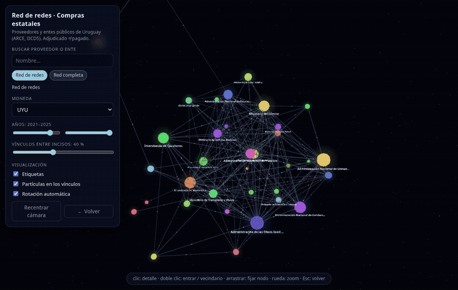

# compras-estatales-uy

App Shiny para ver **quiénes son los proveedores del Estado uruguayo y con qué entes
públicos se vinculan**, con informes descargables en PDF. Datos: adjudicaciones
publicadas por ARCE en formato OCDS, 2002–2025 (1,8 millones de adjudicaciones,
~17.000 proveedores con adjudicaciones en 2021–2025).

🔗 **App en vivo:** https://01a10cf0-1909-a394-8b57-96b25efaaa0c.share.connect.posit.cloud/


*Red de vínculos. Se parte de un proveedor (acá DUODYN S.R.L.), el doble clic sobre un ente
(UTE) hace salir sus proveedores desde el nodo, y un clic abre su detalle. Tamaño del nodo
y grosor de la línea = monto del vínculo.*

## Red 3D: red de redes



Pestaña **Red 3D** (y página independiente `www/red3d.html`, three.js + 3d-force-graph).
Tres niveles que se encadenan:

1. **Red de redes** — cada nodo es un *inciso* (ministerios, intendencias, empresas públicas…);
   dos incisos se unen por los **proveedores que tienen en común** (grosor = monto compartido).
2. **Doble clic en un inciso** — se abren sus entes y sus mayores proveedores; los proveedores
   que también venden a otros incisos tiran un hilo hacia ellos (los *puentes*).
3. **Doble clic en un ente o proveedor** — su vecindario a dos saltos. O **buscalo** por nombre.

Además: **Red completa** (los mayores vínculos, coloreados por inciso), filtros de moneda y años,
densidad ajustable, panel de detalle con sus vínculos principales, resaltado de vecinos al pasar
el mouse, partículas que fluyen por los vínculos, rotación automática y nodos que se pueden fijar
arrastrándolos. Es 100 % del lado del navegador (`www/red3d-data.js` trae los 190 mil pares-año
de mayor monto); necesita WebGL y carga three.js desde jsDelivr.

## Más vistas

| Panorama | Ficha de proveedor | Informe PDF |
|---|---|---|
|  |  |  |

## Qué hace

- **Panorama** — monto por año, mayores proveedores, procedimientos, concentración.
- **Proveedores / Entes públicos** — ranking con el peso de la contraparte principal;
  clic en una fila abre la **ficha** (contrapartes, evolución, mayores adjudicaciones)
  y el botón **Descargar informe PDF**.
- **Vínculos** — red interactiva: se parte de un proveedor o un ente (o del panorama
  general) y se ve con todos sus vínculos; **doble clic** en un nodo expande sus
  contrapartes (salen desde el nodo), un clic abre un panel con su detalle y botones
  para expandir o abrir su ficha. Tamaño del nodo = monto del vínculo; grosor de la línea
  = monto.
- Cada **ficha** trae la tabla de **todos sus vínculos** (clic en una fila salta a la
  contraparte) y el botón **Ver su red de vínculos**.
- **Calidad de datos** — los montos atípicos excluidos y la cobertura por año.

Filtros globales: moneda, años, tipo de procedimiento, incluir/excluir atípicos. **Modo oscuro por defecto**, con un ícono (sol/luna) arriba a la derecha para pasar a modo claro.

## Pipeline

```
Rscript scripts/01_descargar_ocds.R    # ZIP anuales -> insumos/compras_estatales/ (~430 MB)
Rscript scripts/02_codigueras.R        # incisos y unidades ejecutoras (XML de ARCE)
Rscript scripts/03_preparar_datos_app.R [desde] [hasta]   # OCDS -> adjudicaciones.parquet (~25 min)
Rscript scripts/04_pares.R             # marca atípicos + tabla de vínculos (pares.parquet)
Rscript scripts/05_datos_red3d.R       # datos de la Red 3D (www/red3d-data.js)
Rscript scripts/grabar_video_red3d.R   # (opcional) graba el MP4 de la Red 3D con reloj virtual, a 30 fps
shiny::runApp()                        # o Rscript scripts/deploy.R
```

Los dos parquet de `data/app/` se versionan (38 MB + 7 MB) para que la app se pueda publicar desde GitHub;
se regeneran con el pipeline.

La app mantiene en memoria sólo `pares.parquet` (6,8 MB, 650 mil filas) y lee el
detalle de `adjudicaciones.parquet` (60 MB) a demanda con arrow.

## Trampas de la fuente (verificadas)

- **No hay monto total por adjudicación.** Se calcula como Σ cantidad × precio unitario
  de los ítems. Los ítems sin precio no suman.
- **Las monedas no se suman.** No hay tipo de cambio en el dato y el dólar pesa mucho
  (~2.000 M USD/año en 2021–2025): cada vista es de una sola moneda. Pendiente: sumar una
  serie de tipo de cambio (BCU) si se quiere un total único.
- **Montos imposibles** mezclados con megacontratos reales. Se marcan (umbral por
  moneda, `04_pares.R`) y se excluyen por defecto, sin borrarlos.
- Una adjudicación `unsuccessful`/`cancelled` no trae proveedor: el id de la
  «adjudicación» es el número del llamado.
- ~60 % de las adjudicaciones no tiene el llamado asociado (tipo de procedimiento «Sin dato»).
- Los nombres de proveedores y entes cambian entre años: se usa el más reciente por id.
- El proveedor es el id del RUPE (`R/<RUT>`); grupos económicos no se agrupan.

## Informes PDF

`R/informe.R` los arma con ggplot2 + gridExtra sobre `cairo_pdf`: sin LaTeX ni Chrome,
así corren igual en esta PC y en shinyapps.io.

## Arranque rápido (importante en la nube)

Connect Cloud apaga la app tras unos minutos sin uso; cada visita "en frío" tiene que levantarla antes de que el
proxy se rinda (error *«upstream connect error … connection timeout»*). Por eso el arranque está recortado al mínimo:

- los vínculos se leen de `data/app/pares.rds` (factores, 0,25 s) en vez de parquet vía `arrow`; lo precalculado
  (opciones de los buscadores, años, monedas, última fecha) viene de `data/app/meta.rds` (ambos los genera `scripts/04_pares.R`);
- `arrow` y `ggplot2` se cargan **recién** cuando se abre una ficha o se descarga un PDF;
- los gráficos son HTML/CSS (`R/graficos.R`), sin plotly (−1,2 s y ~100 MB de RAM);
- la tipografía está empaquetada en `www/fonts/` (antes el servidor la bajaba de Google en cada arranque).

**El ajuste que más importa está en el panel de Connect Cloud, no en el código:** *Settings → Runtime →
**Idle timeout***. Viene en **5 s** (el mínimo): el proceso de R se apaga 5 s después de cerrarse la última
conexión, y cada visita tiene que levantarlo entre que llega el HTML y se abre el websocket. El resultado era
un `503 upstream connect error … connection timeout` y 30 s o más hasta ver datos (medido en un Chrome real; una app
de "hola mundo" falla igual). Con **60 s** (el máximo) la primera pantalla con datos aparece en ~5 s, también
tras 2 minutos de reposo. Hay que dejarlo así después de cada *Republish*.

Medido en local, con cachés vacías: **8,7 s → 4,5 s** hasta la primera respuesta y **431 → 246 MB** de RAM.
`Rscript scripts/probar_app.R` ejercita todas las salidas (claro y oscuro) sin navegador.

## Publicar

- **Posit Connect Cloud** (plan gratis: 5 apps, 4 GB) — donde está publicada. Desde R, con
  `rsconnect` ≥ 1.11 y credenciales de API de Connect Cloud registradas
  (`rsconnect::connectCloudClientCredentials()`): `Rscript scripts/precalentar_css.R && Rscript scripts/deploy_cloud.R`. También se
  puede conectar el repo en connect.posit.cloud → *Publish* → Shiny → `main` / `app.R`
  (el `manifest.json` ya está; se regenera con `rsconnect::writeManifest()`).
- **shinyapps.io**: `Rscript scripts/deploy.R`.

## Estado

Primera versión. Despliegue en shinyapps.io con `scripts/deploy.R` (app `ComprasEstatales`).
