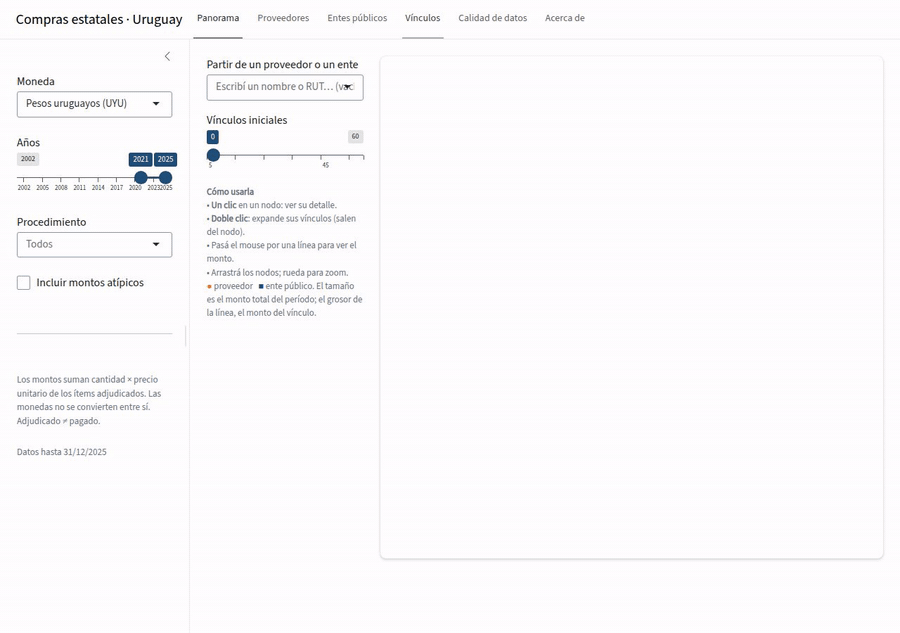
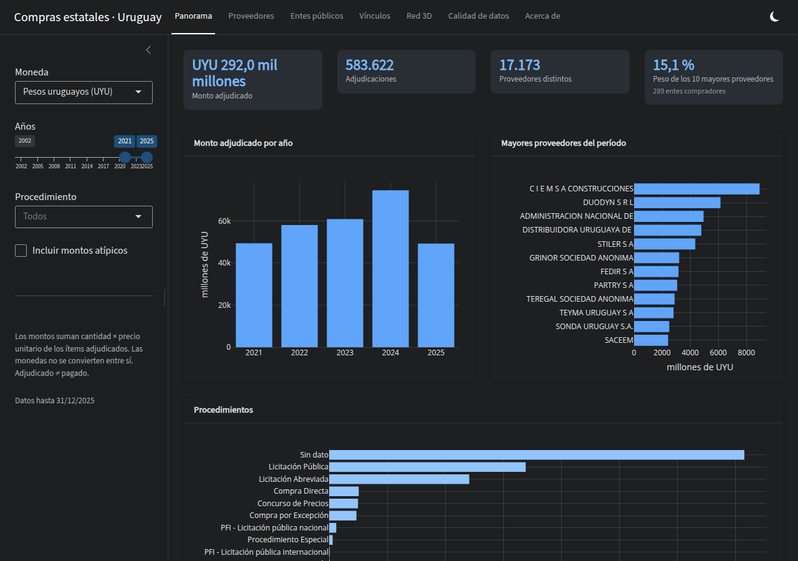
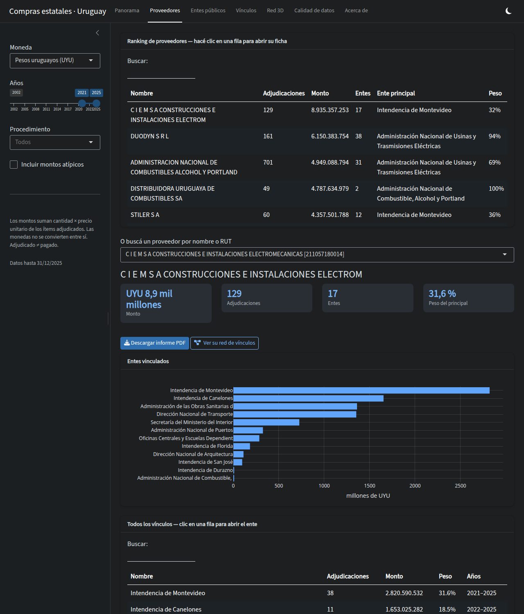
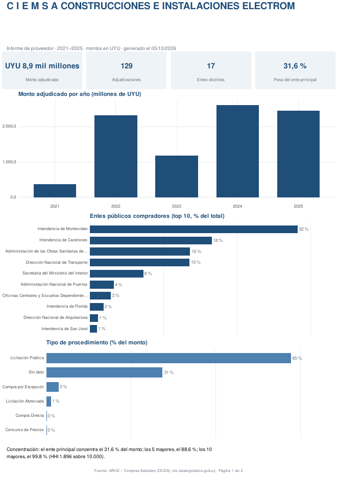

# compras-estatales-uy

App Shiny para ver **quiénes son los proveedores del Estado uruguayo y con qué entes
públicos se vinculan**, con informes descargables en PDF. Datos: adjudicaciones
publicadas por ARCE en formato OCDS, 2002–2025 (1,8 millones de adjudicaciones,
~17.000 proveedores con adjudicaciones en 2021–2025).



*Red de vínculos. Se parte de un proveedor (acá DUODYN S.R.L.), el doble clic sobre un ente
(UTE) hace salir sus proveedores desde el nodo, y un clic abre su detalle. Tamaño del nodo
y grosor de la línea = monto del vínculo.*

| Panorama | Ficha de proveedor | Informe PDF |
|---|---|---|
|  |  |  |

## Qué hace

- **Panorama** — monto por año, mayores proveedores, procedimientos, concentración.
- **Proveedores / Entes públicos** — ranking con el peso de la contraparte principal;
  clic en una fila abre la **ficha** (contrapartes, evolución, mayores adjudicaciones)
  y el botón **Descargar informe PDF**.
- **Vínculos** — red interactiva: se parte de un proveedor o un ente (o del panorama
  general) y se ve con todos sus vínculos; **doble clic** en un nodo expande sus
  contrapartes (salen desde el nodo), un clic abre un panel con su detalle y botones
  para expandir o abrir su ficha. Tamaño del nodo = monto del vínculo; grosor de la línea
  = monto.
- Cada **ficha** trae la tabla de **todos sus vínculos** (clic en una fila salta a la
  contraparte) y el botón **Ver su red de vínculos**.
- **Calidad de datos** — los montos atípicos excluidos y la cobertura por año.

Filtros globales: moneda, años, tipo de procedimiento, incluir/excluir atípicos.

## Pipeline

```
Rscript scripts/01_descargar_ocds.R    # ZIP anuales -> insumos/compras_estatales/ (~430 MB)
Rscript scripts/02_codigueras.R        # incisos y unidades ejecutoras (XML de ARCE)
Rscript scripts/03_preparar_datos_app.R [desde] [hasta]   # OCDS -> adjudicaciones.parquet (~25 min)
Rscript scripts/04_pares.R             # marca atípicos + tabla de vínculos (pares.parquet)
shiny::runApp()                        # o Rscript scripts/deploy.R
```

Los dos parquet de `data/app/` se versionan (38 MB + 7 MB) para que la app se pueda publicar desde GitHub;
se regeneran con el pipeline.

La app mantiene en memoria sólo `pares.parquet` (6,8 MB, 650 mil filas) y lee el
detalle de `adjudicaciones.parquet` (60 MB) a demanda con arrow.

## Trampas de la fuente (verificadas)

- **No hay monto total por adjudicación.** Se calcula como Σ cantidad × precio unitario
  de los ítems. Los ítems sin precio no suman.
- **Las monedas no se suman.** No hay tipo de cambio en el dato y el dólar pesa mucho
  (~2.000 M USD/año en 2021–2025): cada vista es de una sola moneda. Pendiente: sumar una
  serie de tipo de cambio (BCU) si se quiere un total único.
- **Montos imposibles** mezclados con megacontratos reales. Se marcan (umbral por
  moneda, `04_pares.R`) y se excluyen por defecto, sin borrarlos.
- Una adjudicación `unsuccessful`/`cancelled` no trae proveedor: el id de la
  «adjudicación» es el número del llamado.
- ~60 % de las adjudicaciones no tiene el llamado asociado (tipo de procedimiento «Sin dato»).
- Los nombres de proveedores y entes cambian entre años: se usa el más reciente por id.
- El proveedor es el id del RUPE (`R/<RUT>`); grupos económicos no se agrupan.

## Informes PDF

`R/informe.R` los arma con ggplot2 + gridExtra sobre `cairo_pdf`: sin LaTeX ni Chrome,
así corren igual en esta PC y en shinyapps.io.

## Publicar

- **Posit Connect Cloud** (plan gratis: 5 apps, 4 GB): conectar este repo en connect.posit.cloud →
  *Publish* → Shiny → rama `main`, archivo `app.R`. El `manifest.json` ya está en el repo
  (se regenera con `rsconnect::writeManifest()` si cambian los paquetes).
- **shinyapps.io**: `Rscript scripts/deploy.R`.

## Estado

Primera versión. Despliegue en shinyapps.io con `scripts/deploy.R` (app `ComprasEstatales`).
